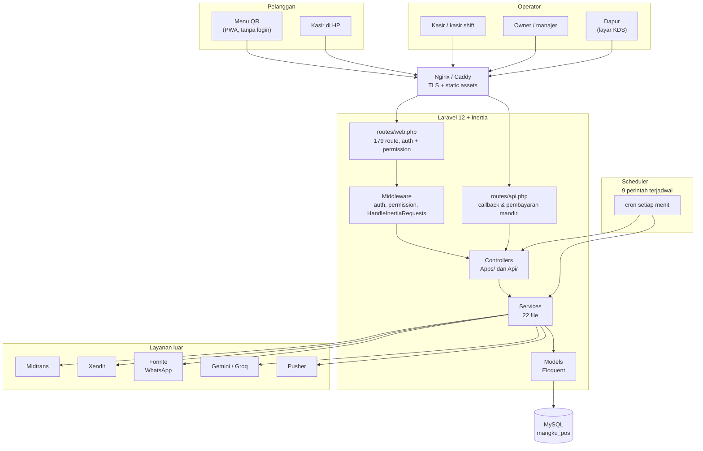
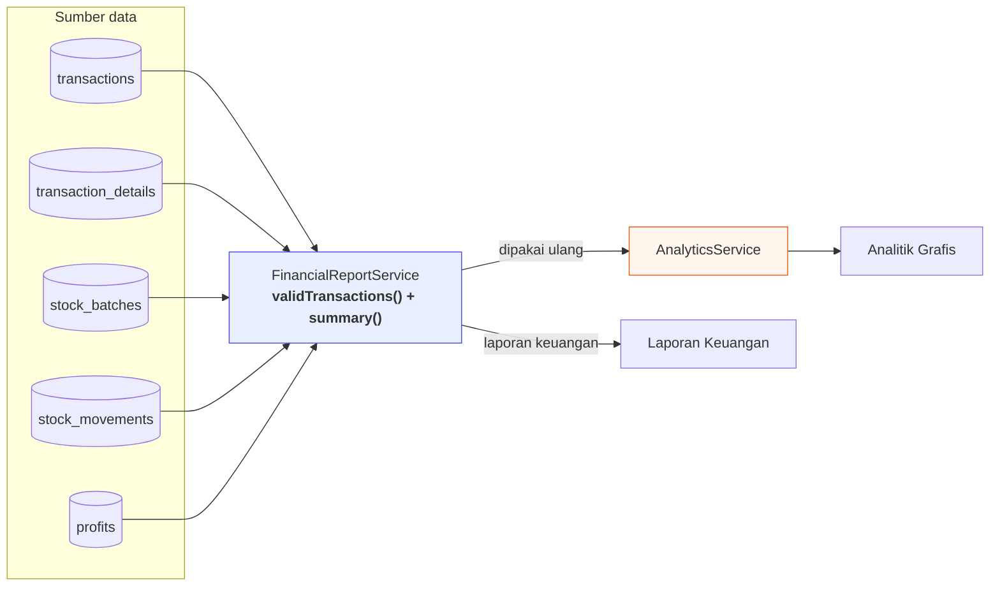
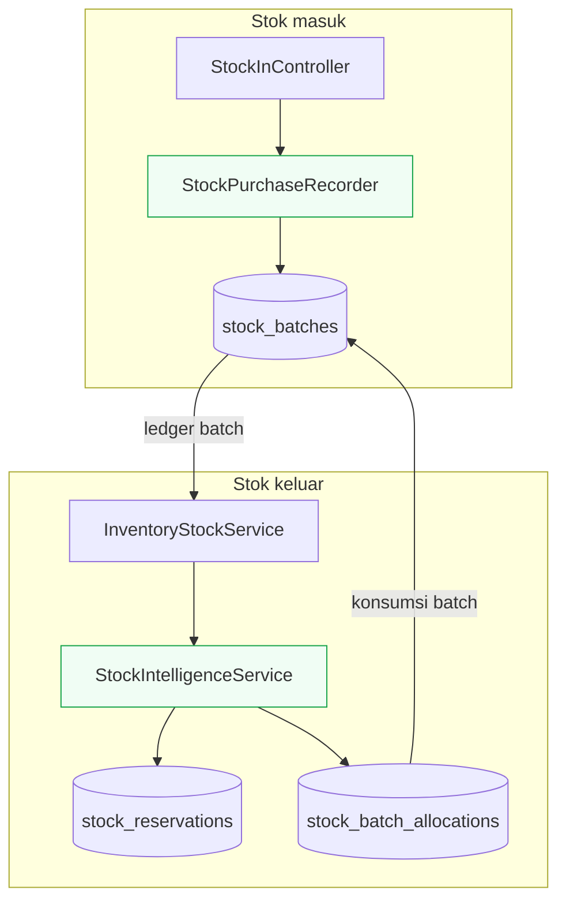
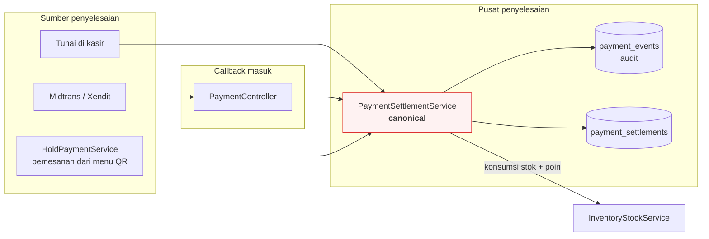
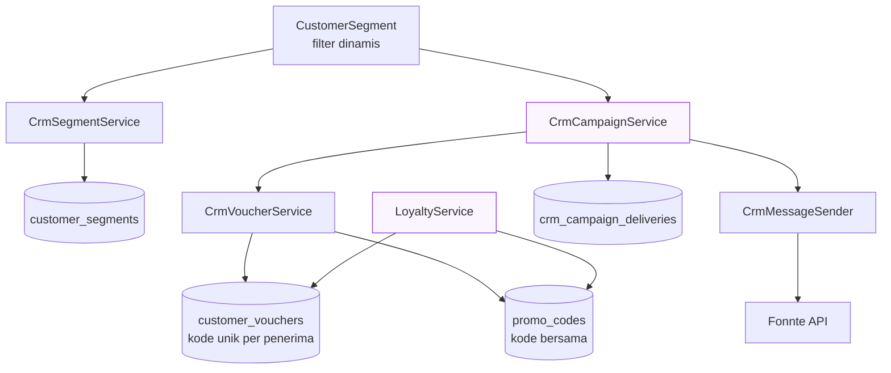
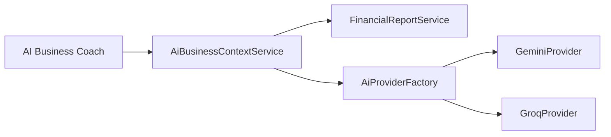
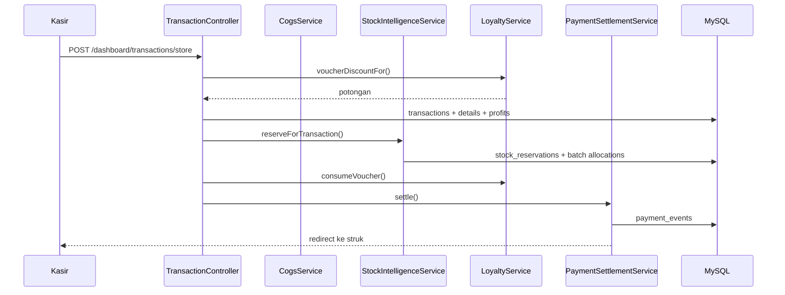

# Arsitektur LakuPOS

Dokumen ini menjelaskan bentuk sistem berdasarkan kode yang benar-benar ada.
Kalau ada bagian yang tidak cocok dengan kode, kodenya yang salah atau dokumen
ini yang perlu diperbarui — bukan sebaliknya.

---

## 1. Peta lapisan



---

## 2. Service dan tanggung jawabnya

Bagian ini yang paling penting dijaga. Setiap service punya satu peran supaya tidak ada perhitungan yang berdiri sendiri-salone.

### Pembukuan — sumber kebenaran tunggal



`AnalyticsService` **tidak** menghitung ulang HPP. Ia memanggil
`FinancialReportService::validTransactions()` dan `summary()`. Karena itu KPI
di analitik tidak mungkin berbeda dari Laporan Keuangan — tidak ada dua
perhitungan yang bisa menyimpang.

Aturan pembukuan yang berlaku di seluruh sistem:

```
omzet bersih      = taxable_amount
HPP               = SUM(buy_price x qty) dari ledger batch
laba kotor        = omzet bersih - HPP
laba bersih       = laba kotor - fee gateway - beban
diskon (%)        = dihitung terhadap omzet SEBELUM diskon
```

### Stok



`stock_batches` adalah ledger. Setiap batch yang dipakai dicatat di
`stock_batch_allocations`, jadi HPP bisa ditelusuri ke batch asal — bukan
sekadar angka yang tersimpan di baris transaksi.

### Pembayaran



`PaymentSettlementService` adalah **satu-satunya** tempat yang mengubah status
pembayaran. Semua sumber — tunai, gateway, dan hold dari menu QR — masuk
melaluinya. Ini yang mencegah kas bank dan stok bergerak dua kali untuk
satu pembayaran.

Verifikasi nominal di `markPaid()` menolak selisih sekecil apa pun:

```php
if (abs($paidAmount - $expected) > 0.009) { /* ditolak */ }
```

### CRM



Voucher pribadi terikat ke `customer_id`, jadi kodenya hanya bisa dipakai
pemiliknya. Batas pemakaian disimpan di `usage_limit` / `used_count`; `status`
hanya akibat dari kuota.

### AI



`AiBusinessContextService` mengambil konteks bisnis lewat
`FinancialReportService` — bukan query sendiri. Jadi angka yang dilihat AI
adalah angka yang sama dengan yang Anda lihat di Laporan Keuangan.

---

## 3. Alur satu transaksi



Langkah yang tidak boleh terlewat: `reserveForTransaction()` berjalan
**sebelum** pembayaran diselesaikan. Kalau pembayaran gagal, reservasi
dilepas. Kalau dibatalkan, `reverseVoucher()` mengembalikan pemakaian voucher.

---

## 4. Scheduler

Sembilan perintah, semuanya `withoutOverlapping()`:

| Perintah | Jadwal | Untuk apa |
|---|---|---|
| `crm:process-campaigns` | tiap menit | lanjutkan campaign yang terpotong |
| `payments:reconcile` | tiap 5 menit | cocokkan pembayaran yang menggantung |
| `stock:release-expired-reservations` | tiap 5 menit | lepas reservasi kedaluwarsa |
| `report:sales-daily` | tiap menit | laporan penjualan terjadwal |
| `inventory:reconcile` | 02:10 | selisih HPP mengendap |
| `repair:profit` | 02:25 | isi HPP estimasi pada data lama |
| `ai:prune-sessions` | 03:05 | bersihkan sesi AI |
| `crm:prune-old-campaigns` | 03:20 | bersihkan delivery lama |
| `report:monthly` | tanggal 1, 01:00 | laporan bulanan |

---

## 5. Batasan yang harus diketahui

Bagian ini sengaja ditulis supaya tidak ada yang terkejut saat deployment.

| Batasan | Akibat | Perbaikan |
|---|---|---|
| `KAFKA_BROKER_ADDRESS` di `.env` | dibaca tidak ada; `config/kafka.php` mencari `KAFKA_BROKERS` | samakan nama variabelnya |
| Order dari menu QR tidak pernah ke Kafka | `customerOrder()` hanya memicu `OrderPlaced` (Pusher), bukan `TransactionCreated` | tambahkan pemanggilan event-nya |
| Tidak ada `trustProxies` | di belakang proxy, `isSecure()` bisa false | tambahkan di `bootstrap/app.php` |
| Tidak ada `forceHttps` | tidak ada pengalihan otomatis ke HTTPS | tambahkan middleware |
| `SANCTUM_STATEFUL_DOMAINS` | pembayaran mandiri dari menu QR ditolak setelah pindah domain | isi di `.env` |
| `MAIL_MAILER=log` | email masuk file log, bukan inbox | isi kredensial SMTP |
| `midtrans_production=0` | masih sandbox | ganti key dan flag ke produksi |

---

## 6. Alur deployment

```mermaid
flowchart LR
    G["git pull"] --> C1["composer install --no-dev -o"]
    C1 --> N1["npm ci"]
    N1 --> N2["npm run build"]
    N2 --> M["php artisan migrate --force"]
    M --> S["php artisan db:seed --class=PermissionSeeder"]
    S --> CA["config:clear / config:cache"]
    CA --> RT["route:clear / view:clear"]
    RT --> SCH["crontab: schedule:run tiap menit"]

    style CA fill:#fef2f2,stroke:#dc2626
```



`php artisan ziggy:generate` perlu dijalankan ulang setiap kali ada route
baru ditambahkan, kalau tidak frontend akan memanggil URL yang tidak dikenal.
