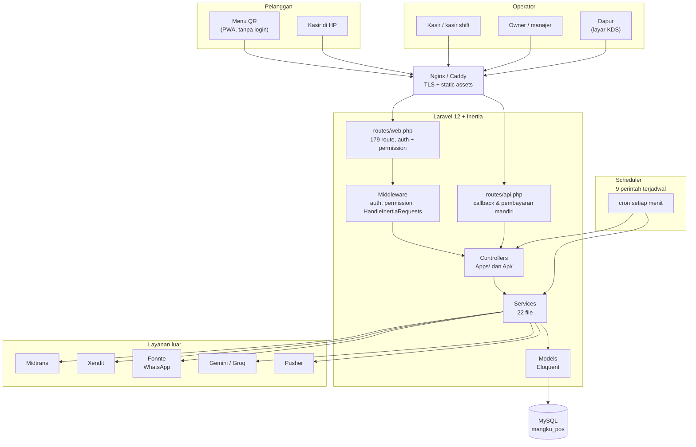
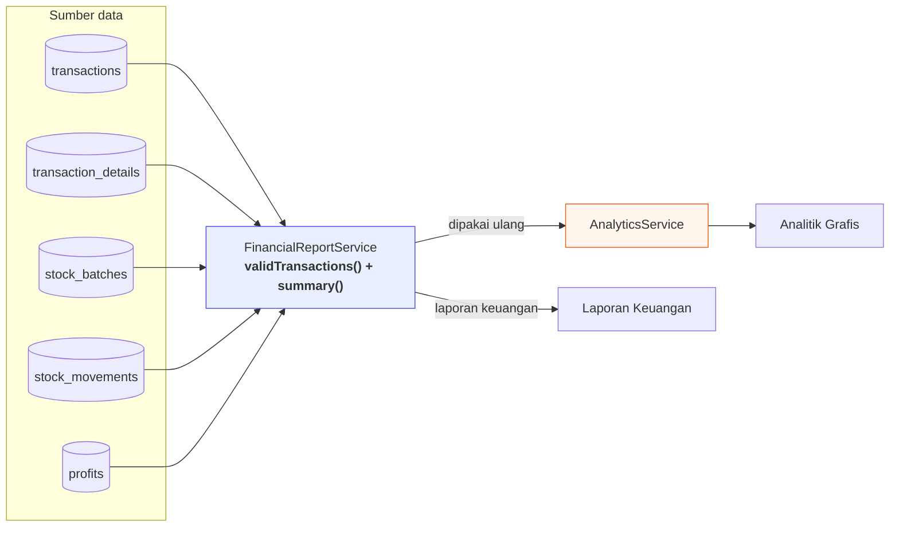
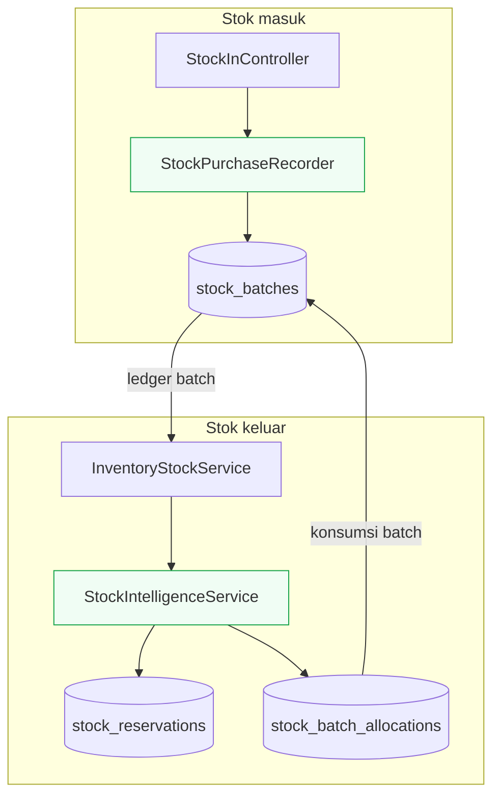
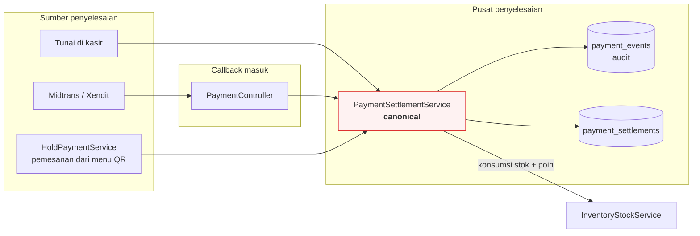
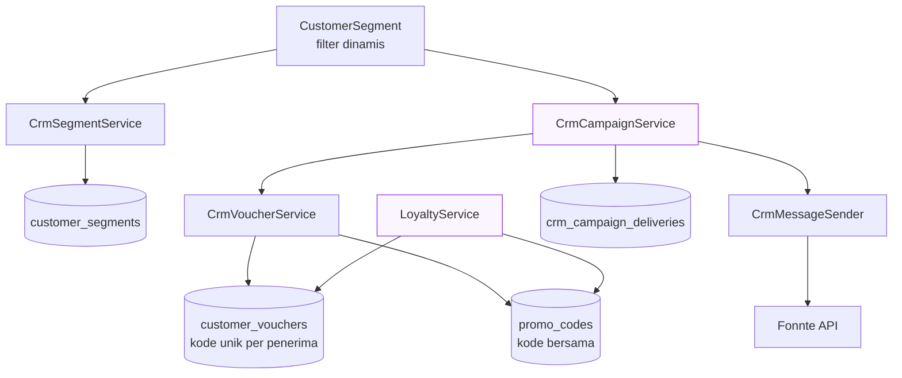
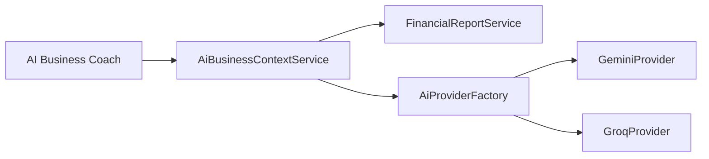
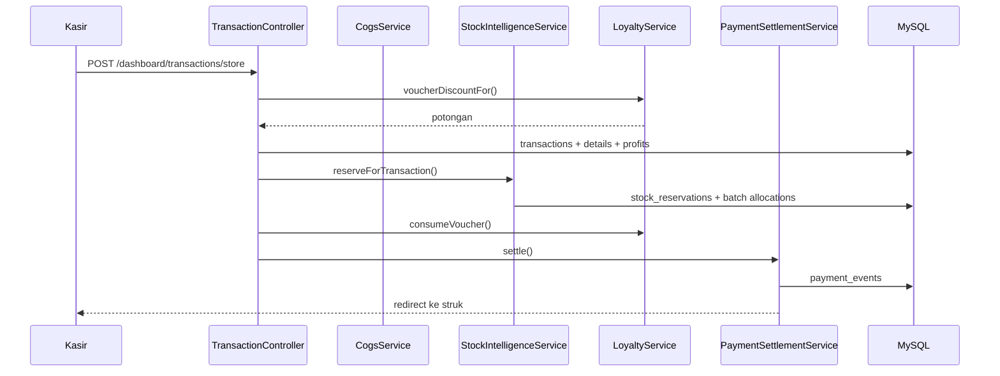
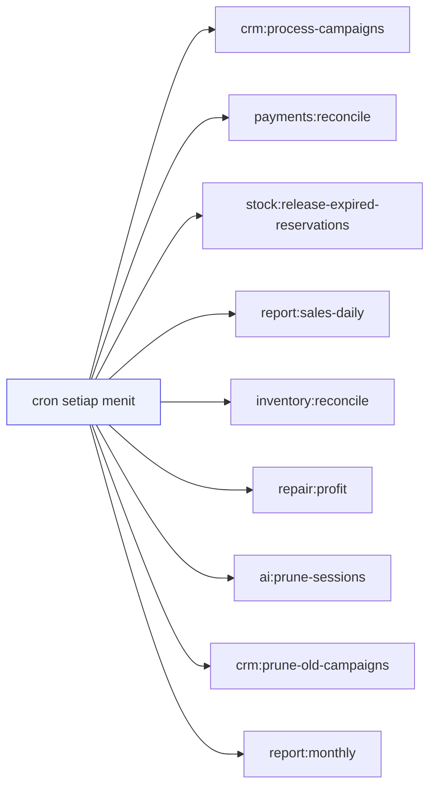

# Arsitektur LakuPOS

Dokumen ini menjelaskan bentuk sistem berdasarkan kode yang benar-benar ada.
Kalau ada bagian yang tidak cocok dengan kode, kodenya yang salah atau dokumen
ini yang perlu diperbarui — bukan sebaliknya.

Setiap diagram disertai penjelasan **kenapa** strukturnya seperti itu, bukan
hanya apa isinya. Bagian "kenapa" itu yang perlu dijaga kalau nanti sistemnya
diubah — sebagian besar struktur di sini dibuat untuk mencegah kelas kesalahan
tertentu, dan begitu hilang teks ini, alasannya ikut hilang.

---

## 1. Peta lapisan



### Penjelasan

**Zona paling kiri bukan satu jenis pengguna.** Ada dua sifat berbeda yang
saling berlawanan. Pelanggan yang memakai menu QR **tidak punya akun sama
sekali** — tidak ada sesi, tidak ada izin. Operator punya keduanya. Sistem
membedakan keduanya di level route, bukan di level controller: `routes/web.php`
dibungkus middleware `auth` + `permission`, sementara `routes/api.php` membuka
beberapa endpoint secara sengaja.

Jadi kalau ada route dashboard yang lupa dibungkus middleware, itu bukan
masalah kecil — halaman yang seharusnya tertutup jadi terbuka.

**Dapur adalah klien, bukan bagian dari alur kasir.** KDS menarik data lewat
polling `GET /dashboard/kitchen/orders` dan mengubah status lewat POST. Tidak
ada push dari server ke dapur. Ini keputusan sadar: kalau KDS memakai websocket,
kegagalan jaringan di dapur akan ikut menjatuhkan transaksi kasir. Dengan
polling, dapur boleh mati tanpa mengganggu apa pun.

**`web.php` dan `api.php` punya tugas yang berbeda, bukan sekadar tempat yang
berbeda.** `web.php` melayani halaman Inertia: 179 route, semua butuh sesi dan
izin. `api.php` hanya punya tiga kelompok: callback pembayaran dari Midtrans dan
Xendit, pengecekan status, dan pembayaran mandiri dari menu QR. Endpoint
callback dikecualikan dari CSRF karena dipanggil server, bukan browser.

**Controller tidak pernah bicara ke layanan luar langsung.** Semua permintaan
keluar lewat service. Ini yang membuat layak dites: `Http::fake()` dan
`Mail::fake()` bisa menyimulasikan lima layanan luar tanpa ada permintaan
sungguhan ke internet.

**Scheduler memanggil service, bukan hanya controller.** Kotak paling bawah
menunjuk ke `Ctl` **dan** `Svc`. Kalau dijadwalkan hanya lewat controller, maka
pekerjaan berkala seperti rekonsiliasi HPP akan butuh HTTP request ke dirinya
sendiri — lambat, boros, dan bisa gagal karena alasan yang tidak berkaitan
dengan pekerjaannya.

---

## 2. Service dan tanggung jawabnya

### 2.1 Pembukuan — sumber kebenaran tunggal



### Penjelasan

Diagram ini adalah yang paling penting di dokumen seluruhnya.

**Lima tabel masuk ke satu service.** Semuanya dibutuhkan karena satu laporan
tidak bisa dihitung dari satu tabel. `transactions` menyimpan nominal dan
status, `transaction_details` menyimpan kuantitas per produk, `stock_batches`
menyimpan harga beli asli dari batch, `stock_movements` mencatat perubahan
stok, dan `profits` menyimpan hasil perhitungan yang sudah dihitung saat transaksi.

**`validTransactions()` menyaring lebih dulu.** Tidak semua baris di
`transactions` boleh dihitung. Transaksi `refunded` dikeluarkan, transaksi
dengan status pembayaran yang belum selesai dikeluarkan, dan transaksi dari
cabang atau sumber yang tidak dikenal ditandai terpisah. Tanpa penyaringan di
satu tempat, setiap laporan harus mengulang daftar penyaringan itu sendiri —
dan pasti akan berbeda satu sama lain.

**`summary()` mengembalikan angka yang sudah jadi.** HPP, omzet, laba kotor,
laba bersih — semuanya sudahdihitung di sini, bukan di frontend.

**Panah "dipakai ulang" itu inti dari seluruhnya.** `AnalyticsService` tidak
punya query HPP sendiri. Ia memanggil `summary()`. Konsekuensinya: tidak
mungkin KPI di analitik berbeda dari Laporan Keuangan, karena keduanya memanggil
fungsi yang sama dengan data yang sama.

Bentuk Kotak oranye menjawab secara langsung "lalu bagaimana kalau ini masih
mungkin berbeda?" — bisa, hanya dalam dua keadaan: kalau `AnalyticsService`
memperhitungkannya sendiri, atau kalau ada laporan ketiga yang muncul
beberapa bulan lagi dan ditulis dari nol. Yang kedua itu yang paling mungkin
terjadi, dan yang paling sulit dicegah tanpa konvensi.

**Aturan pembukuan yang berlaku di seluruh sistem:**

```
omzet bersih      = taxable_amount
HPP               = SUM(buy_price x qty) dari ledger batch
laba kotor        = omzet bersih - HPP
laba bersih       = laba kotor - fee gateway - beban
diskon (%)        = dihitung terhadap omzet SEBELUM diskon
```

Dua baris di bawah perlu dijelaskan karena mudah salah kaprah:

- **Omzet bersih bukan `grand_total`.** `grand_total` sudah termasuk pajak.
  Menjumlahkannya berarti pajak dihitung dua kali — sekali sebagai omzet,
  sekali sebagai beban.
- **Diskon dihitung sebelum diskon.** Kalau diskon 10% itu dibaca sebagai
  "potong 10% dari total", maka pelanggan dengan voucher tinggi jadi membayar
  lebih besar secara proporsional. Ini adalah angka yang dipakai untuk
  keputusan, jadi propagasi yang tidak disengaja di sini merusak seluruh
  laporan.

### 2.2 Stok



### Penjelasan

**Kenapa ada ledger, bukan cuma angka?** Karena harga beli berubah setiap kali
Anda belanja. Kalau HPP sebuah transaksi dihitung dari harga beli *sekarang*,
laporan tahun lalu akan ikut berubah setiap kali Anda belanja baru. Ledger
`stock_batches` menyimpan harga beli pada saat batch itu
masuk, jadi angkanya beku.

**Kenapa batch, bukan tanggal?** Tanggal masuk tidak bisa membedakan. Barang
yang masuk hari Senin dan dibayar Rp12.000, lalu barang yang masuk Senin juga
tapi dibayar Rp13.000, adalah dua batch berbeda — dan dua HPP berbeda.

**Dua service, bukan satu, karena dua momen.** `StockIntelligenceService`
menyimpan batch saat pembelian, sehingga HPP bisa dipercaya sampai keptest
batch asal. `InventoryStockService` yang membacanya dan memutuskan batch mana
yang dipakai (FIFO, rata-rata, atau LIFO, sesuai pengaturan).

**`stock_reservations` dan `stock_batch_allocations` bukan hal yang sama.**
Reservasi means "sudah-this bagian dipesan tapi belum dibayar". Allocation
means "bagian ini benar-benar terpakai". Pemisahan ini yang membuat pembatalan
bisa membatalkan pemesanan tanpa mengoreksi pembukuan.

**HUB: `consumeVoucher()` bukan milik Stok** — lihat 2.3, karena voucher punya
siklus hidup sendiri yang mirip dengan reservasi.

### 2.3 Pembayaran



### Penjelasan

**Tiga sumber, satu pintu.** Ini kondisi yang paling sering merusak pembukuan.
Kalau tunai diselesaikan di satu tempat dan gateway di tempat lain, cepat atau lambat ada
satu jalur yang lupa mengurangi stok — dan sistem tidak akan pernah
menyadarinya.

**`PaymentController` hanya menerjemahkan, tidak memutuskan.** Ia menerima
JSON dari Midtrans atau Xendit, memverifikasi tanda tangannya, lalu
meneruskannya. Semua keputusan ada di `PaymentSettlementService`.

**`payment_events` adalah audit, bukan status.** Tabel ini mencatat setiap
callback yang masuk, termasuk yang ditolak. Yang penting: baris tetap ditulis
saat callback ditolak. Kalau penolakan hanya dicatat di log, lalu file log-nya
rotating, maka Anda tidak akan pernah tahu bahwa ada pembayaran yang
menggantung.

**Kotak merah bukan tanda bahaya.** Warnanya menandai satu-satunya tempat yang
berwenang mengubah status pembayaran. Kalau suatu saat ada fitur baru yang
membutuhkan idempotensi — dan hampir pasti akan ada — dokumentasi ini adalah
tempat pertama yang perlu dibaca.

**Verifikasi nominal menolak selisih sekecil apa pun.** Di `markPaid()`:

```php
if (abs($paidAmount - $expected) > 0.009) { /* ditolak */ }
```

Toleransi 0.009 ada karena pembulatan floating-point, bukan untuk Deuts
menerima selisih. Alasannya sudah tertulis di kode: mencatat pembayaran yang
tidak cocok akan membuat Kas Bank di neraca melebihi uang yang benar-benar
masuk, dan itu tidak bisa.center_of_truth Only Nominal Benar yang Berlaku.

### 2.4 CRM



### Penjelasan

**Segment bukan daftar nama.** Ia menyimpan *aturan*, bukan pelanggan. Filter
disimpan sebagai `rules` (tier, total belanja, frekuensi, bulan lahir), dan
`CrmSegmentService` menerjemahkannya jadi query. Ini yang membuat segment
tidak perlu diperbarui setiap kali ada pelanggan baru.

**Campaign menyimpan resep, bukan kode.** Yang tersimpan di campaign adalah
nama, tipe, nilai, dan awalan kode. Kode aslinya diterbitkan saat pengiriman.
Karena itu satu campaign dengan 500 penerima tetap menyimpan satu baris, bukan
lima ratus.

**Dua tabel voucher karena dua model bisnis yang berbeda.**

```
customer_vouchers  -> kode unik per penerima, terikat customer_id
promo_codes        -> satu kode untuk semua, punya kuota global
```

Kalau code keduanya digabung, kode pribadi akan ikut terhitung dalam kuota
global, dan kode bersama tidak bisa dipakai pelanggan mana pun. Pemisahan ini
memang membuat dua tempat yang harus dijaga — tapi menggabungkannya akan
menyebabkan kesalahan yang lebih sulit dilacak.

**`LoyaltyService` yang memeriksa voucher, bukan CRM.**Voucherdiedarkan oleh
campaign, tetapi ditukar di kasir — jadi yang mengaturnya adalah service yang
sama dengan yang mengelola poin. Kalau tukar voucher ada di service CRM, maka
kasir akan bergantung pada modul yang secara logika bukan miliknya.

**Voucher pribadi terikat ke `customer_id`.** Kodenya hanya bisa dipakai
pemiliknya; kalau pelanggan lain mengetiknya, tidak ditemukan dan penolakannya
sama dengan kode yang tidak pernah ada. Batas pemakaian ada di `usage_limit`
dan `used_count`; `status` hanya akibat — voucher baru jadi `used` setelah
kuotanya habis.

### 2.5 AI



### Penjelasan

**AI membaca lewat service yang sama.** Ini satu-satunya alasan diagram ini
pendek. Kalau `AiBusinessContextService` punya query sendiri, AI akan
memper advises angka yang berbeda dari yang Anda lihat di Laporan Keuangan —
dan Anda tidak akan pernah bisa mengetahuinya, karena AI terdengar sangat
meyakinkan.

**`AiProviderFactory` ada supaya provider bisa diganti.** Gemini dan Groq
sudah jadi dua implementasi yang berbeda. Ketiga'tiga punya biaya dan batas
yang berbeda; memilih lewat factory berarti perubahan cukup di satu tempat.

**Tidak ada kotak "prompt" di sini.** Prompt adalah data, bukan arsitektur.

---

## 3. Alur satu transaksi



### Penjelasan

Diagram ini dibaca dari atas ke bawah sebagai urutan yang benar-benar terjadi,
dan urutannya punya alasan.

**Voucher dihitung paling awal, sebelum transaksi dibuat.** Kalau tidak,
`transactions` akan menyimpan total yang belum potongan, dan setiap laporan
harus menghitung ulang. Memotong lebih awal berarti satu angka benar yang
disimpan sekali.

**`reserveForTransaction()` berjalan sebelum pembayaran diselesaikan.**
Ini keputusan yang paling penting di diagram ini. Stok di-reserve begitu
pesanan diterima, bukan setelah uang masuk.

Kalau tidak begitu, ada jeda antara kasir menekan "Bayar" dan pelanggan
benar-benartransfer — dan di jeda itu, pesanan kedua bisa memakai stok yang
sudah dipesan pesanan pertama. Setelah uang masuk, baru batch-nya benar-benar
dikurangi.

**Reservasi ada justru supaya bisa dilepas.** Kalau pembayaran gagal atau
transaksi dibatalkan, `stock:release-expired-reservations` mengembalikan
baris reservasi itu ke status tersedia. Tanpa pemisahan reserve dari consume,
membatalkan transaksi akan meninggalkan stok terkunci permanen.

**`consumeVoucher()` dipanggil hanya setelah pembayaran dipastikan.** Untuk
pembayaran gateway, vouchernya belum berpindah sampai callback diterima
(status `reserved`, bukan `used`). Kalau callback-nya tidak pernah datang,
reservasi vouchernya dilepas sendiri oleh `payments:reconcile`.

**Kotak `CS` (CogsService) sengaja tidak punya panah di diagram ini.**
arryaخدمات HPP yang sama. Detail itu ada di 2.1.

---

## 4. Scheduler



### Penjelasan

Sembilan perintah, semuanya `withoutOverlapping()`. Flag itu wajib: tanpa
itunya, eksekusi yang lambat akan ditumpuki oleh eksekusi berikutnya.

| Perriot | Jadwal | Untuk apa |
|---|---|---|
| `crm:process-campaigns` | tiap menit | lanjutkan campaign yang terpotong |
| `payments:reconcile` | tiap 5 menit | cocokkan pembayaran yang menggantung |
| `stock:release-expired-reservations` | tiap 5 menit | lepas reservasi kedaluwarsa |
| `report:sales-daily` | tiap menit | laporan penjualan terjadwal |
| `inventory:reconcile` | 02:10 | selisih HPP mengendap |
| `repair:profit` | 02:25 | isi HPP estimasi pada data lama |
| `ai:prune-sessions` | 03:05 | bersihkan sesi AI |
| `crm:prune-old-campaigns` | 03:20 | bersihkan delivery lama |
| `report:monthly` | tanggal 1, 01:00 | laporan bulanan |

**Tiga perintah pertama adalah jaringan pengaman, bukan fitur.** Campaign,
pembayaran, dan reservasi stok bisa menggantung karena alasan di luar kendali
— request yang mati di tengah jalan, callback yang tidak pernah datang,pelanggan
yang menutup browser. Ketiganya punya batas waktu setelah itu ditandai macet
dan boleh diambil alih.

**Empat perintah berikutnya dijadwalkan pagi buta** dan tujuannya memindahkan
kesalahan yang diam-diam mengendap jadi sesuatu yang terlihat. `inventory:reconcile`
menemukan selisih HPP; `repair:profit` mengisi HPP pada transaksi lama yang
dibuat sebelum ledger batch ada.

**Dua perintah terakhir adalah pekerjaan rutin.** Membersihkan data yang tidak
perlu disimpan, supaya tabel tidak tumbuh tanpa batas.

**Jika cron tidak berjalan, yang palingimmediately terlihat hilang adalah
laporan terjadwal.** Yang lebih halus: campaign besar tidak akan pernah
selesai, reservasi stok tidak akan pernah dilepas, dan voucher yang menggantung
tidak akan pernah kembali.

---

## 5. Batasan yang harus diketahui

Bagian ini sengaja ditulis supaya tidak ada yang terkejut saat deployment. Ini
bukan daftar kekurangan — semuanya kondisi nyata saat dokumen ini ditulis.

| Batasan | Akibat | Perbaikan |
|---|---|---|
| `KAFKA_BROKER_ADDRESS` di `.env` | dibaca tidak ada; `config/kafka.php` mencari `KAFKA_BROKERS` | samakan nama variabelnya |
| Order dari menu QR tidak pernah ke Kafka | `customerOrder()` hanya memicu `OrderPlaced` (Pusher), bukan `TransactionCreated` | tambahkan pemanggilan event-nya |
| Tidak ada `trustProxies` | di belakang proxy, `isSecure()` bisa false | tambahkan di `bootstrap/app.php` |
| Tidak ada `forceHttps` | tidak ada pengalihan otomatis ke HTTPS | tambahkan middleware |
| `SANCTUM_STATEFUL_DOMAINS` | pembayaran mandiri dari menu QR ditolak setelah pindah domain | isi di `.env` |
| `MAIL_MAILER=log` | email masuk file log, bukan inbox | isi kredensial SMTP |
| `midtrans_production=0` | masih sandbox | ganti key dan flag ke produksi |
| `APP_DEBUG=true` | setiap error menumpahkan isi `.env` ke publik | `false` sebelum aplikasi dipakai |

### Penjelasan

**Baris pertama paling mengelabui.** Nilai bawaannya di `config/kafka.php`
sama persis dengan yang tertulis di `.env`, jadi tidak pernah terasa. Begitu
Anda mengubah broker di `.env`, perubahannya diam-diam diabaikan.

**Baris kedua bukan soal konfigurasi.** Order dari menu QR tidak pernah
mencapai Kafka sama sekali, karena `customerOrder()` hanya memicu notifikasi
Pusher lalu keluar. Listener Kafka hanya naik dari checkout kasir. Yang
diperbaiki bukan domain atau token — tapi satu pemanggilan event yang hilang.

**Baris kedelapan yang palingIterable.** `APP_DEBUG=true` membuat setiap
exception yang belum tertangani menampilkan stack trace beserta isi `.env`,
termasuk `FONNTE_TOKEN` dan kredensial gateway. Ini bukan sesuatu yang akan
muncul di test suite — hanya terjadi di server.

---

## 6. Alur deployment

```mermaid
flowchart LR
    G["git pull"] --> C1["composer install --no-dev -o"]
    C1 --> N1["npm ci"]
    N1 --> N2["npm run build"]
    N2 --> Z["php artisan ziggy:generate"]
    Z --> M["php artisan migrate --force"]
    M --> S["php artisan db:seed --class=PermissionSeeder"]
    S --> CA["config:clear lalu config:cache"]
    CA --> RT["route:clear lalu view:clear"]
    RT --> SCH["crontab: schedule:run tiap menit"]

    style CA fill:#fef2f2,stroke:#dc2626
```



### Penjelasan

**Urutan itu tidak boleh diacak.** `ziggy:generate` harus setelah `npm run
build` tapi sebelum `config:cache`, karena frontend memanggil route Laravel
lewat nama — bukan URL langsung. Kalau belum di-regenerate, frontend memanggil
URL yang tidak dikenal.

**`config:cache` diwarnai merah karena dua alasan.** Pertama, kalau ada
perubahan `.env` tanpa `config:clear` sebelumnya, nilai lamanya masih dipakai.
Kedua — dan ini yang pernah jadi masalah nyata — `env()` yang dipanggil
langsung di luar file config akan mengembalikan `null` setelah cache aktif.
Token Fonntesebelumnya dibaca persis seperti itu, jadi `config:cache` akan
membuat seluruh pengiriman WhatsApp gagal dengan pesan "token belum
dikonfigurasi" padahal tokennya ada. Sekarang tokennya lewat `config/services.php`.

**`--no-dev -o` bukan opsional di produksi.** Tanpa `--no-dev`, paket pengujian
ikut ter-install dan menambah attack surface. Tanpa `-o`, autoloader dibangun
dengan memindai seluruh direktori — lambat, dan setiap file baru di produksi
justru memperlambatnya.

**`PermissionSeeder` wajib dijalankan setelah migrate.** Tabel permission
selalu kosong di instalasi baru, dan setiap route dashboard dilindungi
middleware permission. Tanpa seeding, setiap kasir melihat 403 di mana pun.

**Crontab wajib, bukan opsional.** Lihat bagian 4 — tanpa cron, campaign tidak
selesai dan reservasi tidak pernah dilepas.